---

## AI engineering grounded in mathematics and software design

I build **AI-backed applications and reliable software systems**, using mathematical modelling and quantitative methods to make behavior explicit, testable, and measurable.

My work connects **AI engineering, software architecture, algorithms, and mathematical research**. I am particularly interested in systems that retrieve evidence, adapt pretrained models, evaluate AI behavior, optimize decisions, and remain inspectable when something goes wrong.

**Current focus:** evidence-grounded decision support · LLM adaptation · AI evaluation · reliable agent runtimes · search engineering · .NET infrastructure.

## Selected engineering work

These six repositories provide the clearest view of how I work across AI, backend systems, and applied engineering.

<table>
<tr>
<td width="50%" valign="top">

### [Evidence-Grounded Decision Support](https://github.com/peymanpro/Evidence-Grounded-Decision-Support)

An AI-assisted decision-support backend combining deterministic quantitative analysis with evidence provenance, bounded research retrieval, adaptive interviews, specialist perspectives, evaluation artifacts, safety checks, and audit events.

**Stack:** Python · FastAPI · PostgreSQL · SQLAlchemy · Docker

[Repository](https://github.com/peymanpro/Evidence-Grounded-Decision-Support) · [Latest release](https://github.com/peymanpro/Evidence-Grounded-Decision-Support/releases)

</td>
<td width="50%" valign="top">

### [Pretrained LLM Adaptation](https://github.com/peymanpro/Pretrained-LLM-Adaptation)

A reproducible downstream NLP workflow using BANKING77 and DeBERTa-v3-small: dataset checks, baselines, frozen-encoder training, LoRA/PEFT adaptation, held-out evaluation, error analysis, and inference.

**Focus:** model adaptation · experimental control · reproducibility

[Repository](https://github.com/peymanpro/Pretrained-LLM-Adaptation) · [Latest release](https://github.com/peymanpro/Pretrained-LLM-Adaptation/releases)

</td>
</tr>
<tr>
<td width="50%" valign="top">

### [AI Evaluation Engineering](https://github.com/peymanpro/AI-Evaluation-Engineering)

A provider-neutral evaluation layer with typed test cases, reusable graders, agent-trajectory analysis, security regression cases, statistical comparisons, quality/cost trade-offs, and regression gates.

**Focus:** measurable AI quality · repeatable evaluation · failure analysis

[Repository](https://github.com/peymanpro/AI-Evaluation-Engineering) · [Latest release](https://github.com/peymanpro/AI-Evaluation-Engineering/releases)

</td>
<td width="50%" valign="top">

### [Production Agent Systems](https://github.com/peymanpro/Production-Agent-Systems)

A runnable, provider-neutral agent runtime demonstrating structured tool contracts, permission checks, bounded retries and timeouts, checkpoints, recovery, circuit breaking, trace, audit, and replay.

**Focus:** reliability · runtime policy · safe tool execution

[Repository](https://github.com/peymanpro/Production-Agent-Systems) · [Latest release](https://github.com/peymanpro/Production-Agent-Systems/releases)

</td>
</tr>
<tr>
<td width="50%" valign="top">

### [Elasticsearch Search Platform](https://github.com/peymanpro/Elasticsearch-Search-Platform)

A Django REST Framework application centred on practical search engineering: index design, text analysis, relevance, fuzzy matching, autocomplete, facets, filtering, pagination, and explainability.

**Stack:** Python · Django REST Framework · Elasticsearch · Docker

[Repository](https://github.com/peymanpro/Elasticsearch-Search-Platform) · [Latest release](https://github.com/peymanpro/Elasticsearch-Search-Platform/releases)

</td>
<td width="50%" valign="top">

### [RateLimitEngine](https://github.com/peymanpro/RateLimitEngine)

An extensible .NET 8 rate-limiting library built around concurrency safety, deterministic behavior, in-memory and Redis-backed state, ASP.NET Core integration, weighted requests, observability, and explicit failure semantics.

**Stack:** C# · .NET 8 · ASP.NET Core · Redis · NuGet

[Repository](https://github.com/peymanpro/RateLimitEngine) · [Release v1.0.0](https://github.com/peymanpro/RateLimitEngine/releases/tag/v1.0.0)

</td>
</tr>
</table>

[Browse all public repositories →](https://github.com/peymanpro?tab=repositories)

## How I approach engineering

I aim to make the reasoning behind a system visible, not just make the happy path work.

**Define the problem → establish a baseline → choose a method → implement → test → measure → analyze failures → improve.**

I prefer deterministic behavior where it is practical, explicit boundaries around model and provider calls, reproducible experiments, and claims supported by tests or measured evidence. Passing automated checks is useful evidence about a codebase; it is not, by itself, proof of real-world performance or complete production readiness.

## Mathematical and research background

My academic work is grounded in mathematics, including fixed-point and best-proximity-point theory, fuzzy analysis, differential and integral equations, and related mathematical modelling.

That background influences how I formulate constraints, reason about algorithms, study learning methods, and evaluate computational behavior.

I also develop **[Learning-Native Adaptive Software Framework (LNASF)](https://github.com/peymanpro/Learning-Native-Adaptive-Software-Framewor-Or-LNASF)**, a research direction exploring software components that observe outcomes, learn from evidence, adapt under explicit policies, and evaluate their behavior. Its proposed contribution is still under validation; the reference implementations demonstrate selected ideas rather than a fully validated general framework.

Related mathematical implementations include the [Convex Quadratic Programming Solver](https://github.com/peymanpro/Convex-Quadratic-Programming-Solver) and [Event-Driven Metaheuristic Optimization](https://github.com/peymanpro/Event-Driven-Metaheuristic-Optimization).

## Engineering foundations

| Area | Technologies and methods |
|---|---|
| **Languages** | Python · C# · TypeScript · JavaScript |
| **AI / ML** | Machine learning · Deep learning · LLM adaptation · RAG · embeddings · information retrieval · evaluation |
| **Backend & infrastructure** | FastAPI · .NET / ASP.NET Core · Django REST Framework · PostgreSQL · Redis · messaging · distributed systems |
| **Frontend** | React · Next.js · Angular · Blazor |
| **Engineering practice** | API design · automated testing · CI · Docker · reproducible experiments · benchmarks · observability |

## Research and professional links

<table>
<tr>
<td width="50%" valign="top">

**Professional**

[Website & research](https://psalimi.ir/en/research) · [Portfolio](https://peymanpro.github.io/portfolio/) · [LinkedIn](https://www.linkedin.com/in/psalimi) · [GitHub](https://github.com/peymanpro)

</td>
<td width="50%" valign="top">

**Scholarly**

[Google Scholar](https://scholar.google.com/citations?user=1By69aAAAAAJ&hl=en) · [ORCID](https://orcid.org/0000-0002-8763-8394) · [ResearchGate](https://www.researchgate.net/profile/Peyman-Salimi) · [Zenodo](https://doi.org/10.5281/zenodo.22142517)

</td>
</tr>
</table>

---

*research · engineering · intelligent systems*

